# ExGrid

[](https://github.com/AkiraMisawa/ex-grid/actions/workflows/ci.yml)
[](https://www.nuget.org/packages/ExGrid)
[](https://akiramisawa.github.io/ex-grid/)
[](https://github.com/AkiraMisawa/ex-grid/blob/badges/coverage.md)
[](https://github.com/AkiraMisawa/ex-grid/blob/badges/coverage.md)
[](https://github.com/AkiraMisawa/ex-grid/blob/badges/coverage.md)
[](https://github.com/AkiraMisawa/ex-grid/blob/badges/coverage.md)
[](https://github.com/AkiraMisawa/ex-grid/blob/badges/coverage.md)
[](https://github.com/AkiraMisawa/ex-grid/blob/badges/coverage.md)

**Excel-like grids for Blazor, built for reading money and risk numbers.**

A spreadsheet user's selection, keyboard and clipboard, virtualised on both axes so a million rows
keep the same DOM, and a grid that refuses rather than guesses: a number that does not fit shows
`####`, never a shorter number, and a copy is never truncated.

**[Documentation and live examples →](https://akiramisawa.github.io/ex-grid/)**

[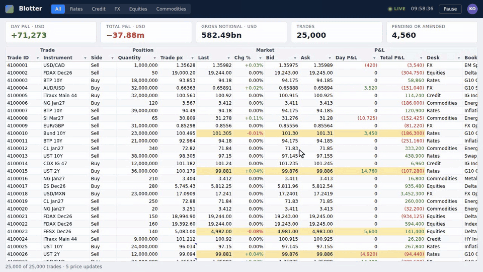](https://akiramisawa.github.io/ex-grid/showcase/blotter)

One repository, four products, each a separate package:

| | |
|---|---|
| **ExGrid** | The grid. Display-oriented: your application holds the rows, ExGrid shows them and tells you what the user asked for |
| **ExSheet** | A general-purpose sheet — cells addressed `A1`, Formulas computed as Excel computes them — drawn by ExGrid |
| **ExPivot** | Excel's PivotTable — Filters, Columns, Rows and Values in a Fields pane — drawn by ExGrid |
| **ExChart** | Charts of the data the grids show, or your application hands over, drawn as SVG — charted from a selection in a click |

Each has a MudBlazor Wrapper (`ExGrid.MudBlazor`, `ExSheet.MudBlazor`, `ExPivot.MudBlazor`, `ExChart.MudBlazor`).

## Features

### ExGrid

- **Virtualised on both axes** — a million rows and a hundred columns render the same DOM
- **Pinned columns**, **Header Groups**, column resize and reorder
- **Rectangular selection** and the keyboard as Excel has them: arrows, Ctrl+arrows, Shift to
  extend, Enter and Tab cycling, typing to enter a cell
- **Copy and paste** as a spreadsheet user expects, with the shape rules written down; Delete,
  Ctrl+D / Ctrl+R and Ctrl+Z, with your application keeping the history
- **Sorting and filtering**, with filter panels and a column menu; the bundled
  `GridSource.From` sorts and filters a list in memory, or your server does it
- **Find (Ctrl+F)** over every row, not only the painted ones
- **Excel's status-bar figures** (Average, Count, Sum…) over the selection, every selected row included
- **Cell editing** and validation, a **Context Menu**, Row Stripes, live updates
- **Replaceable Chrome** — menus, filter panel, Cell Editor and loading indicator are seams a
  design system fills; swapping them does not change behaviour


<details>
<summary>The same under MudBlazor</summary>

[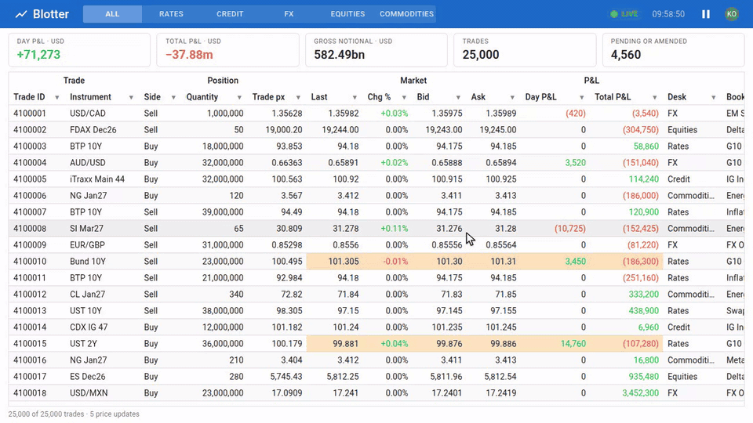](https://akiramisawa.github.io/ex-grid/showcase/blotter?chrome=mud)

</details>

The parts of a grid, as [the Docs Site](https://akiramisawa.github.io/ex-grid/exgrid) and the API name them:

<!-- figure grid-anatomy -->
[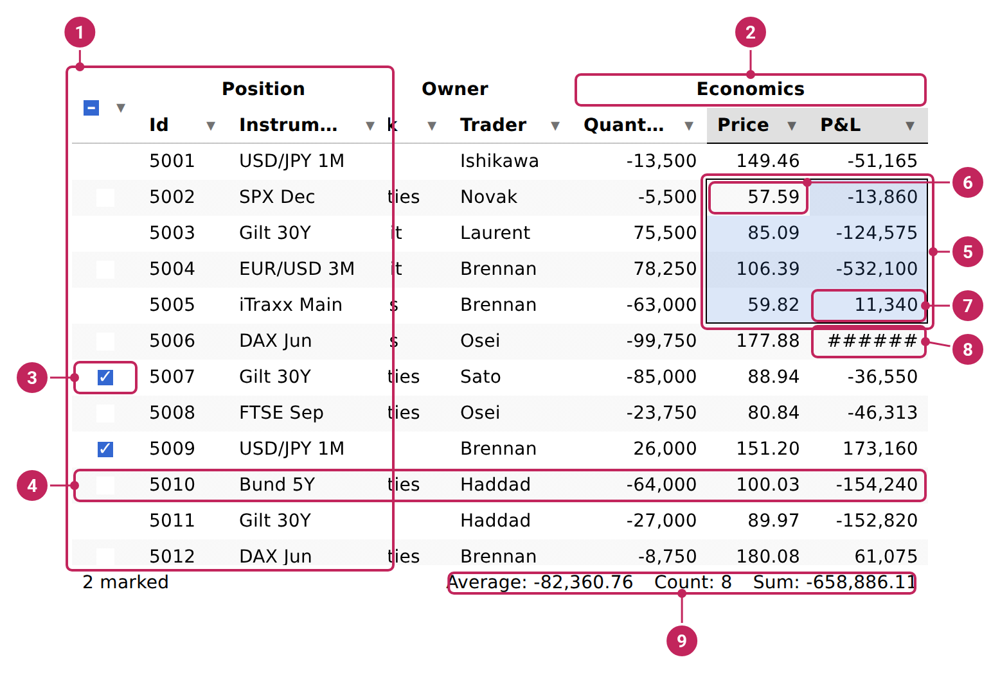](https://akiramisawa.github.io/ex-grid/exgrid)

1. **Pinned Column**: held at the edge while the others pan under it
2. **Header Group**: a label over adjacent columns
3. **Mark Column**: its ticks are Row Marks, which your application holds
4. **Row Stripe**: on every second row of the result
5. **Selection**: rectangles of cells, by position
6. **Focus**: the active cell, which typing enters
7. **Extent**: the end that moves as the range grows
8. **Overflow**: a number too wide shows ####, never a shorter number
9. **Selection Summary**: Excel's status-bar figures over the Selection
<!-- /figure grid-anatomy -->

### ExSheet

- Excel's extent, 1,048,576 rows by 16,384 columns, held sparsely
- Formulas in Excel's syntax with a declared set of functions, each giving Excel's result — a
  function outside the set is `#NAME?`, never an approximation
- Recalculation of only what a change reaches; circular references reported as `#CIRC!`
- Formula Bar, Name Box, Headings, completion of function and table names, pointing at cells
  with the arrows or the mouse while a Formula is typed
- Insert and delete rows and columns, the fill handle, Format Cells (number format, alignment,
  font, fill, borders), an opt-in toolbar
- The **Sheet Document** is yours to keep: Entries, never Values, so a saved Sheet recomputes the
  same on a server as in the browser

The parts of a sheet, as [the Docs Site](https://akiramisawa.github.io/ex-grid/exsheet) and the API name them:

<!-- figure sheet-anatomy -->
[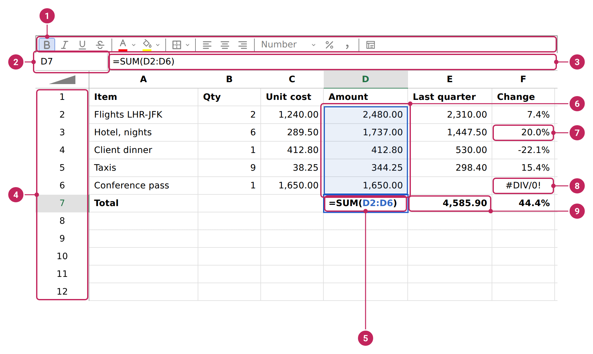](https://akiramisawa.github.io/ex-grid/exsheet)

1. **Sheet Toolbar**: opt-in buttons that act on the Selection
2. **Name Box**: where the Focus is
3. **Formula Bar**: the Focus cell's Entry, editable here too
4. **Headings**: column letters and row numbers
5. **Cell Editor**: the uncommitted text, over its cell
6. **Reference Outline**: the cells a Reference in the Formula names
7. **Number Format**: turns a Value into the text shown, here 0.0%
8. **Error Value**: an error, carried as data; here a division by nothing
9. **Value**: what a cell's Entry evaluates to
<!-- /figure sheet-anatomy -->


[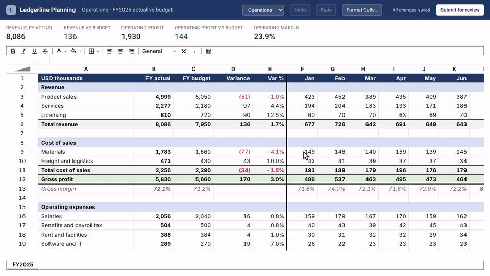](https://akiramisawa.github.io/ex-grid/showcase/budget)

<details>
<summary>The same under MudBlazor</summary>

[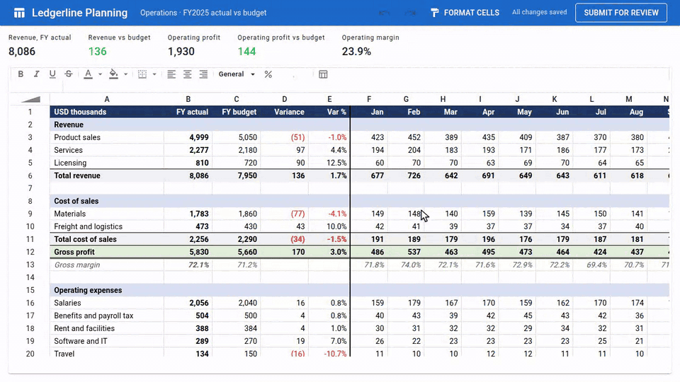](https://akiramisawa.github.io/ex-grid/showcase/budget?chrome=mud)

</details>

### ExPivot

- Excel's PivotTable semantics: Sum to Varp, subtotals and grand totals, the Compact, Outline
  and Tabular forms, expand and collapse, Hidden Items, sorting by label or value, Show Values As,
  Show Details
- The **PivotTable Fields** pane with drag and drop, Field Settings and Value Field Settings
- Money summed exactly — never through a `double`
- In-process data, CSV, a database, or a server answering with leaf aggregates; live data folded
  in as Change Batches

The parts of a pivot, as [the Docs Site](https://akiramisawa.github.io/ex-grid/expivot) and the API name them:

<!-- figure pivot-anatomy -->
[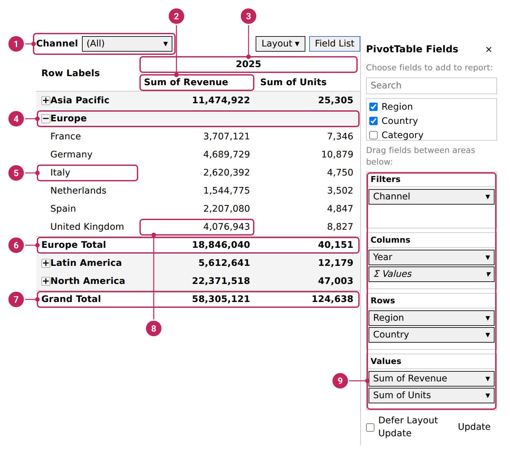](https://akiramisawa.github.io/ex-grid/expivot)

1. **Report filter**: a field in Filters
2. **Value Field**: Revenue, with its Aggregation, Sum
3. **Header Group**: a column Item over its columns
4. **Group row**: an outer Item, heading its Items
5. **Item**: one value of a field in Rows
6. **Subtotal**: of the group, at its foot
7. **Grand total**: of everything the report counts
8. **Cell**: one per combination of Items, computed from its Leaf Aggregate
9. **Areas**: Filters, Columns, Rows and Values
<!-- /figure pivot-anatomy -->

[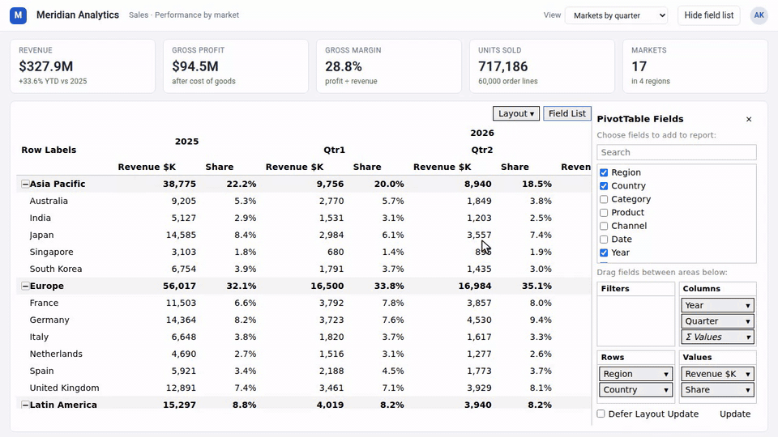](https://akiramisawa.github.io/ex-grid/showcase/sales)

<details>
<summary>The same under MudBlazor</summary>

[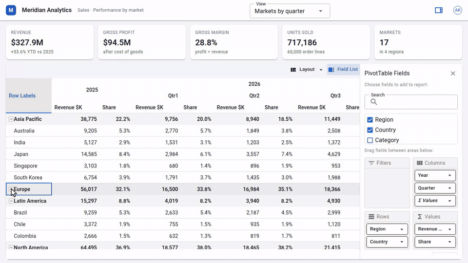](https://akiramisawa.github.io/ex-grid/showcase/sales?chrome=mud)

</details>

### ExChart

Line, step, point, candle, scatter and 3D surface charts of the family's data, drawn as SVG by Blazor.
Chart a grid's selection from its context menu, or hand ExChart a definition in your data's terms.
Three packages: `ExChart.Engine` (the definitions and the arithmetic, no UI), `ExChart` (the
components) and `ExChart.MudBlazor` (the Chart Dock, a toolbar and menus in MudBlazor's controls).

- **Every series says what it is** — a level is a line, a rate over an interval a step, an amount
  per period is drawn per period, a price range a candle, an observation an unjoined mark; a
  series without a Series Kind is refused, never drawn with a default
- **Only what it is given** — no spline, no extrapolation; a missing value is a gap, never a zero,
  and a curve between quotes is your analytics', declared as such and named in the Notes
- **Read with the pointer** — the tooltip lists every series at the pointer's position and the
  guide runs down every panel; a drag narrows the range, a legend entry hides its series, and
  both come back to your application as Chart Filters, because the chart holds no View State
- **Charted from the grid** — the chart keeps following the rows it was made from, and a click on
  a point goes to its row
- **Too many points for the pixels** is said, not hidden: a series is thinned to each pixel's
  minimum and maximum, and candles merge into the market's own weeks or months
- **A 3D surface** of a vol table, turned with the mouse or the keys, and sliced into a smile or a
  term structure with a click
- **Read aloud, and saved** — a summary for a screen reader, "View as table", and the CSV, SVG and
  PNG on one click

A selection charted into the Chart Dock under MudBlazor, a new tab beside the first:

[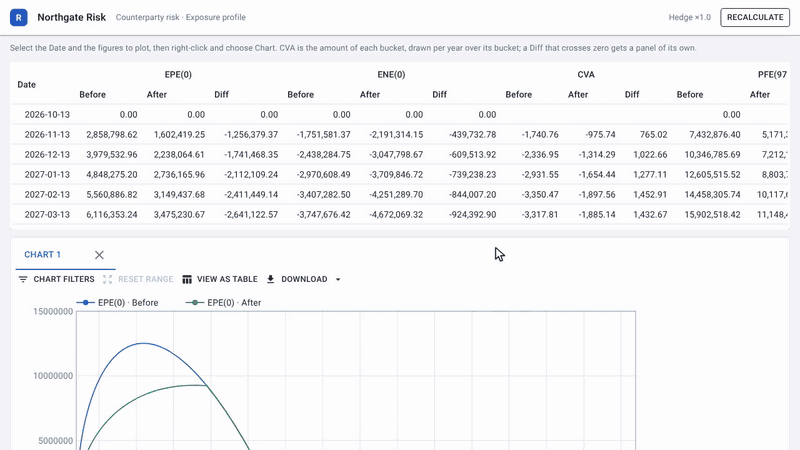](https://akiramisawa.github.io/ex-grid/showcase/exposure?chrome=mud)

The parts of a chart, as [the Docs Site](https://akiramisawa.github.io/ex-grid/exchart) and the API name them:

<!-- figure chart-anatomy -->
[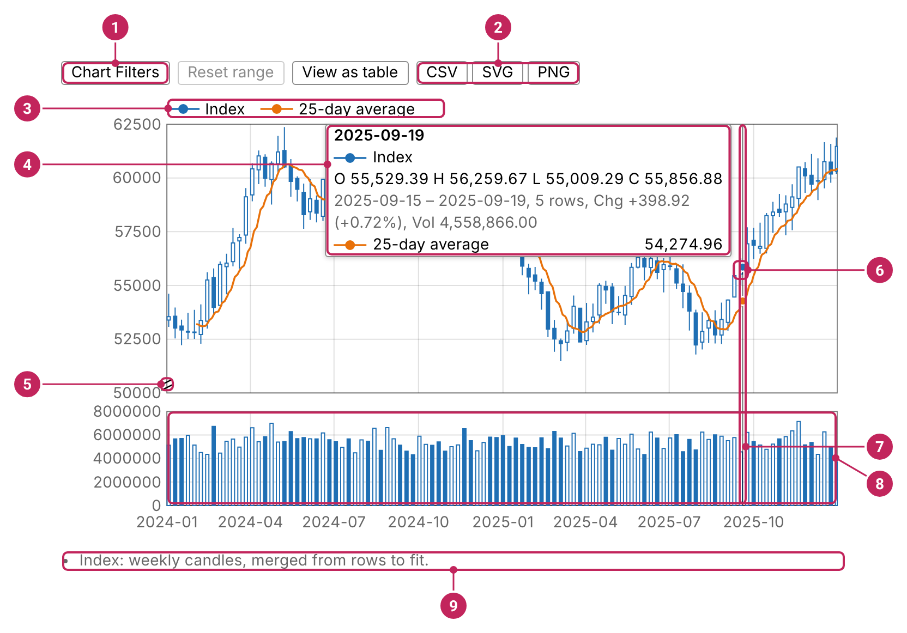](https://akiramisawa.github.io/ex-grid/exchart)

1. **Chart Filters**: the series shown and the range, raised to your application, which holds them
2. **Export**: the CSV, SVG and PNG of what the chart draws, each saved on one click
3. **Legend**: a click on an entry hides its series
4. **Tooltip**: every series of the panel, at the position the pointer is over
5. **Break mark**: the axis does not start at zero, and says so at its foot
6. **Merged candle**: too many sessions for the plot's pixels: each candle is a week, and the tooltip names its rows
7. **Guide**: the pointer's position, drawn down every panel
8. **Panel**: the volume, below its candles on a value axis of its own
9. **Notes**: what the chart did to fit, said in words, with the Consumer's own notes
<!-- /figure chart-anatomy -->

The Chart Dock beside the grid it charts:

<!-- figure chart-dock-anatomy -->
[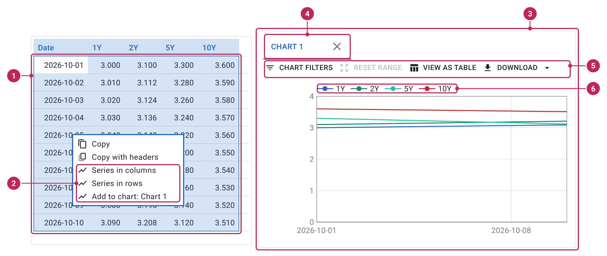](https://akiramisawa.github.io/ex-grid/exchart)

1. **Selection**: the cells to chart, the Date beside the figures
2. **Chart commands**: in the grid's context menu: a new chart with a series a column or a row, or the series added to a chart already open
3. **Chart Dock**: the MudBlazor Wrapper's place for charts made from the grid: beside it or below it, never over it
4. **Tab**: one a chart, which keeps following the rows it was made from
5. **Toolbar**: Chart Filters, the table and the files, in MudBlazor's own buttons and menus
6. **Legend**: a series a tenor, coloured from the MudBlazor theme's palette
<!-- /figure chart-dock-anatomy -->

Reading a chart: the tooltip and the guide follow the pointer, a legend entry hides a series, and a
drag narrows the range that Chart Filters show:

[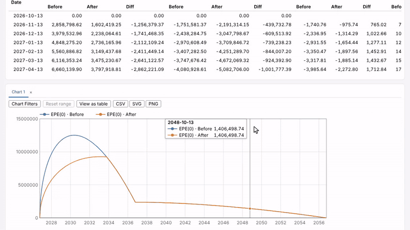](https://akiramisawa.github.io/ex-grid/showcase/exposure)

<details>
<summary>The 3D vol surface, candles that merge, and a scatter</summary>

The EURUSD volatility surface beside its quotes, turned with a drag and the arrow keys, then sliced
into a smile and a term structure:

[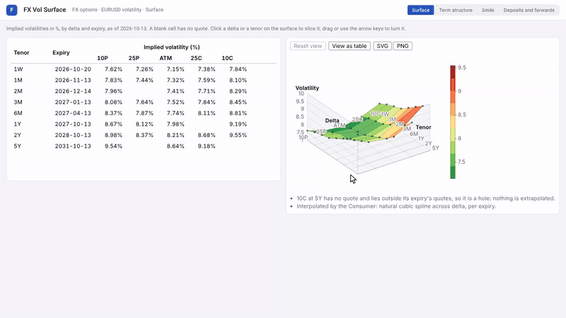](https://akiramisawa.github.io/ex-grid/showcase/fx-volatility)

Ten years of an index merged into monthly candles, days again when the range is narrowed:

[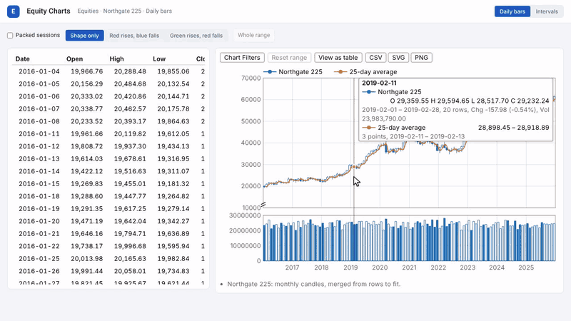](https://akiramisawa.github.io/ex-grid/showcase/equity-index)

200 names' CDS spread against leverage: a rectangle narrows both axes, and a click on a mark goes to its row:

[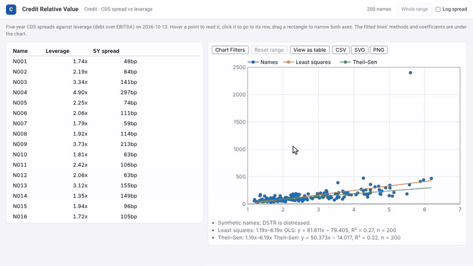](https://akiramisawa.github.io/ex-grid/showcase/cds-spread)

</details>

The [Chart section of the Docs Site](https://akiramisawa.github.io/ex-grid/exchart) has a page and
an Example for each of these, and five Showcases put them in a desk's screens:
[exposure profile](https://akiramisawa.github.io/ex-grid/showcase/exposure),
[curves](https://akiramisawa.github.io/ex-grid/showcase/curves),
[FX volatility](https://akiramisawa.github.io/ex-grid/showcase/fx-volatility),
[CDS spread vs leverage](https://akiramisawa.github.io/ex-grid/showcase/cds-spread) and
[equity index](https://akiramisawa.github.io/ex-grid/showcase/equity-index).

## Quick start

```sh
dotnet add package ExGrid --prerelease
```

Place the stylesheet component in the head: `<ExGridStylesheet />` in `App.razor`'s `<head>` in a
Blazor Web App, or, in a standalone WebAssembly application's `Program.cs`:

```csharp
builder.RootComponents.Add<ExGrid.Components.ExGridStylesheet>("head::after");
```

```razor
@using ExGrid
@using ExGrid.Components

<ExGrid TRow="Trade" Source="_source" Columns="_columns" />

@code {
    private readonly InMemoryGridSource<Trade> _source = GridSource.From(Trade.Sample());

    private readonly GridColumn<Trade>[] _columns =
    [
        new("Book", ColumnType.Text, t => t.Book),
        new("Notional", ColumnType.Number, t => t.Notional),
        new("TradeDate", ColumnType.Date, t => t.TradeDate),
    ];
}
```

The whole family is published to NuGet as prereleases at one shared version, `0.1.0-beta.N` and then `0.1.0-rc.N`
([ADR-0042](docs/adr/0042-prereleases-ship-before-sign-off-and-only-a-stable-version-waits-for-it.md)).
Each package depends on exactly the versions of the others it was built with, so upgrade them
together. A MudBlazor application adds each product's Wrapper:

```sh
dotnet add package ExGrid.MudBlazor --prerelease    # for a MudBlazor application
dotnet add package ExSheet --prerelease             # the sheet; ExSheet.Engine alone computes on a server
dotnet add package ExSheet.MudBlazor --prerelease
dotnet add package ExPivot --prerelease             # the pivot table; ExPivot.Engine alone aggregates
dotnet add package ExPivot.MudBlazor --prerelease
dotnet add package ExChart --prerelease             # the charts; ExChart.Engine alone holds the definitions
dotnet add package ExChart.MudBlazor --prerelease
dotnet add package ExGrid.Data.Arrow --prerelease   # a Snapshot as Apache Arrow
```

Each package's own readme takes it from there:

| Product | Readmes |
|---|---|
| ExGrid | [`ExGrid`](src/ExGrid/README.md), [`ExGrid.MudBlazor`](src/ExGrid.MudBlazor/README.md) |
| ExSheet | [`ExSheet`](src/ExSheet/README.md), [`ExSheet.Engine`](src/ExSheet.Engine/README.md), [`ExSheet.MudBlazor`](src/ExSheet.MudBlazor/README.md) |
| ExPivot | [`ExPivot`](src/ExPivot/README.md), [`ExPivot.Engine`](src/ExPivot.Engine/README.md), [`ExPivot.MudBlazor`](src/ExPivot.MudBlazor/README.md) |
| ExChart | [`ExChart`](src/ExChart/README.md), [`ExChart.Engine`](src/ExChart.Engine/README.md), [`ExChart.MudBlazor`](src/ExChart.MudBlazor/README.md) |
| Data | [`ExGrid.Data`](src/ExGrid.Data/README.md), [`ExGrid.Data.Arrow`](src/ExGrid.Data.Arrow/README.md) |

**Requirements:** .NET 10 or newer, Chrome or Edge, and an interactive render mode. ExGrid is
verified under WebAssembly; every browser test also runs under Blazor Server.

## See it running

Every component runs live on the **[Docs Site](https://akiramisawa.github.io/ex-grid/)**: each
page has Examples you can drive with the mouse and the keyboard, the code each one runs, and the
API. A switch at the top runs every Example under the built-in Chrome or MudBlazor's. The
Showcases are whole applications:
[a trade blotter](https://akiramisawa.github.io/ex-grid/showcase/blotter),
[a budget sheet](https://akiramisawa.github.io/ex-grid/showcase/budget),
[a sales analysis](https://akiramisawa.github.io/ex-grid/showcase/sales), and ExChart's five, from
[an exposure profile](https://akiramisawa.github.io/ex-grid/showcase/exposure) to
[an equity index](https://akiramisawa.github.io/ex-grid/showcase/equity-index)
(all of them on [the Showcases page](https://akiramisawa.github.io/ex-grid/showcases)).

To run the site locally, clone the repository (the .NET 10 SDK is all it needs; see
[CONTRIBUTING](CONTRIBUTING.md) for Nix) and open <http://localhost:5310>:

```sh
dotnet run --project samples/ExGrid.Docs --urls http://localhost:5310
```

## Design

- **Rather than be quietly wrong, say it cannot be done.** Copy is never truncated, paste never
  spills outside the selection, the selection is dropped when the order changes, and a number
  that does not fit becomes `####`.
- **The grid neither holds nor executes.** The data, sorting, filtering and edits belong to your
  application. The grid displays what it is given and tells you what the user asked for — or
  you hand it `GridSource.From` and let the bundled source do it.
- **Chrome renders; the core decides.** A design system replaces how the menus and editors look,
  never what they mean.
- **JavaScript only where Blazor cannot do the job**, on an allowlist.

Every decision is recorded with its reasons in [`docs/adr/`](docs/adr/), and the vocabulary in
[`CONTEXT.md`](CONTEXT.md).

## Status

**Beta.** The specification is settled and every test layer passes in CI, but the API may change
between prereleases. The family's ten packages ship together as `0.1.0-beta.N`, then as release
candidates `0.1.0-rc.N`; a stable version waits
for the [Definition of Done](docs/definition-of-done.md) to be signed off. What remains is in
[`docs/implementation-status.md`](docs/implementation-status.md).

## Contributing

Building the repository, its layout, the ground rules and the test layers are in
[CONTRIBUTING.md](CONTRIBUTING.md).

## License

[MIT](LICENSE).
