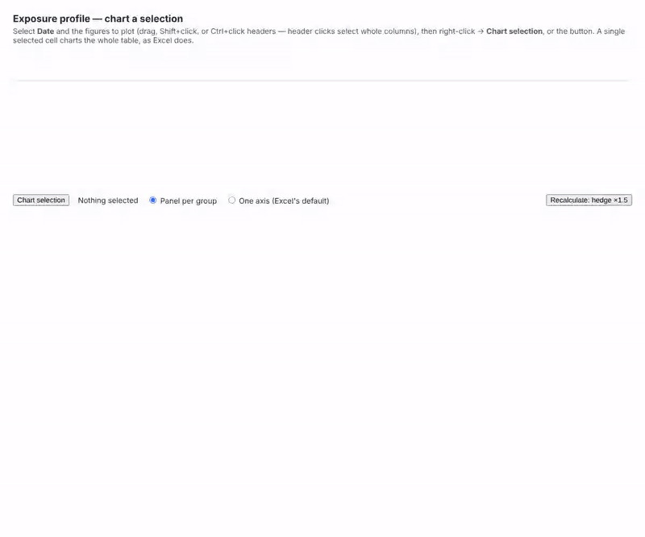
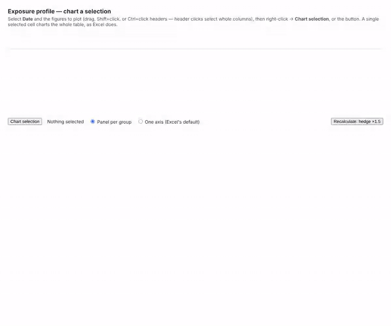
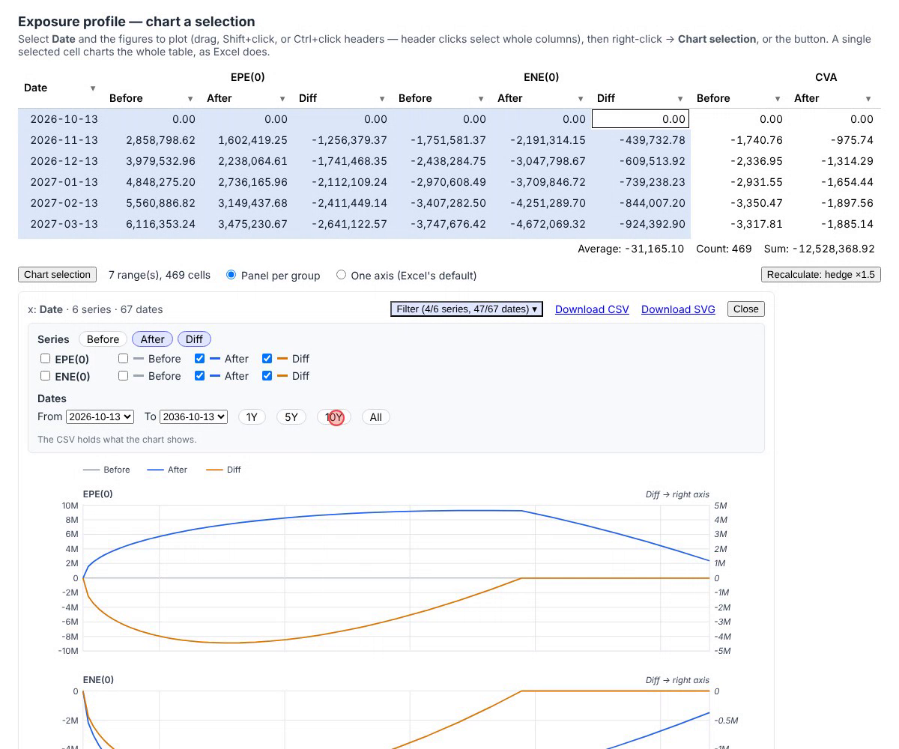
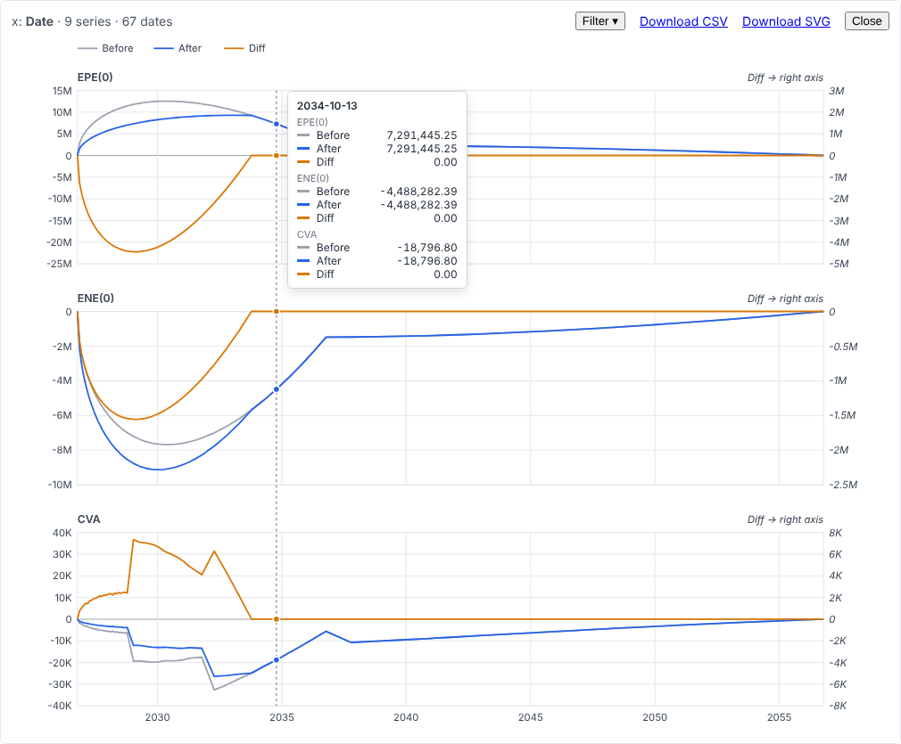
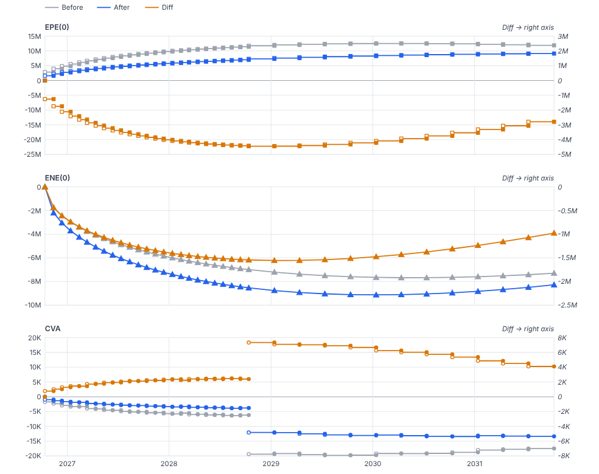
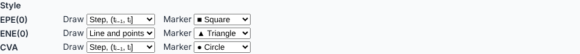
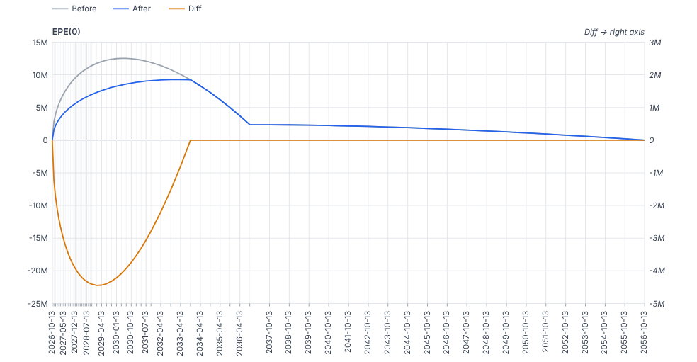
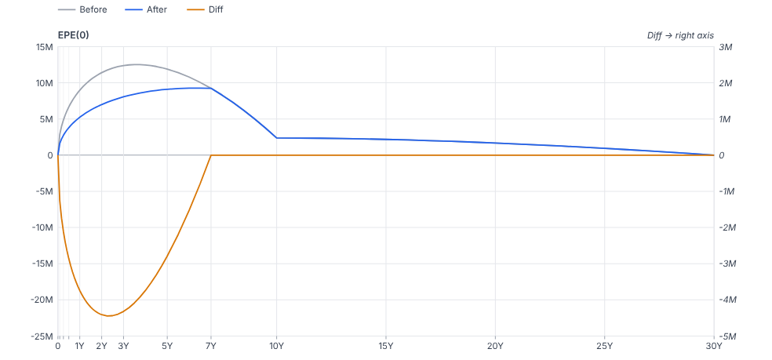
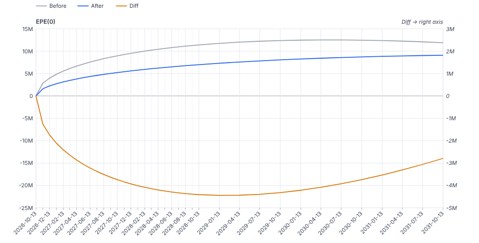

# exposure-chart — a disposable proof of concept

What charting an ExGrid selection would look like, before any ADR is written: an exposure profile
(Date × EPE(0) / ENE(0) / CVA, each Before / After / Diff, under Header Groups), a selection
turned into a chart, and the chart's data exported as CSV. **Nothing here is a decision**; it is
the material for the grilling that follows it. Throw it away once that is done.

```sh
nix develop -c dotnet run --project spikes/exposure-chart -- --urls http://localhost:5410
```

Select **Date** and the figures (drag, or click a header and Ctrl+click others), then right-click
→ **Chart selection**, or the button. One selected cell charts the whole table, as in Excel.





| | |
|---|---|
|  |  |
|  |  |
|  |  |
|  |  |
|  |  |

## How it is built

- **No change to the core.** The context menu's Consumer command (ADR-0036) already carries the
  selected ranges and the Row Sequence Version they were taken under; that is all a chart needs.
- **The chart is defined in the data's terms** (`ChartDefinition`): the axis column, the series
  columns by name, the rows by their date. A sort or a recalculation leaves it meaning the same
  thing; a stale version is refused (spine rule 6).
- **Nothing is guessed.** Headers are not data; series names and panels come from the Header
  Groups ("EPE(0) · Before"); the axis is the one Date column, and a selection without one, with
  two, or with a text column is refused by name.
- **SVG written in C#** (`ChartSvg`). The hover guide and the dots are CSS `:hover`, instant and
  with no circuit traffic. The downloaded file carries a native `<title>` per date instead of a
  tooltip, since it has no page to draw one.
- **The tooltip is one listener, in ADR-0029's shape** (`wwwroot/exposure-chart.js`; the user
  allowed widening the JavaScript allowlist for it, 2026-10-13 — the ADR is for the grilling to
  write). It reports the date under the pointer **only when it changes** and when the pointer
  leaves — 48 frames on the circuit for 89 mousemoves across 44 dates — and never measures: Blazor
  draws the tooltip at a percentage of the chart's width that C# computed. Each report carries the
  drawing's version, and one taken against an earlier drawing (a filter changed meanwhile) is
  dropped, not shown against the new one (spine rule 6). Values read through the column's own
  format, so the tooltip and the cell say the same digits.
- **Chart Filters, as Excel's funnel beside a chart** (`ChartView`): series by checkbox, by
  Header Group, or by leaf across every group ("hide every Before"); dates by a From/To range or a
  horizon (1Y / 5Y / 10Y / All) rather than Excel's one checkbox per category, which for 67 dates
  is a list nobody reads. It narrows the chart and its CSV, never the grid or the definition, and
  a hidden series keeps its colour slot so "After" stays blue when "Before" goes.
- **How points are joined is declared per series** (`SeriesStyle`, chosen per Header Group under
  Filter → Style): a line, a line with points, points only, or a step — over (tᵢ₋₁, tᵢ] or over
  [tᵢ, tᵢ₊₁). A step is drawn as mathematics draws one: the end that takes the value is a
  filled marker, the end that does not is an open one, and where the next level is equal the
  function is continuous and no open marker is drawn; there is no vertical riser, since the
  function takes no value between the levels. Markers are a circle, a square, a diamond or a
  triangle. CVA defaults to the (tᵢ₋₁, tᵢ] step, because that is the piecewise-constant profile
  its bucket-by-bucket integral uses; a line between the dates would show a profile the
  calculation never saw.
- **The horizontal axis is set in three independent choices** (`XAxisStyle`, Filter → Horizontal
  axis): where the ticks go (calendar boundaries, every date in the data, or the market's tenors
  from the first date — 1M, 3M, 6M, 1Y, 2Y, 5Y, 10Y …), how they are labelled (yyyy, yyyy-MM,
  yyyy-MM-dd, MMM yyyy, or a tenor, "18M", "5Y"), and at what angle (0°, 45°, 90°, read upwards
  as in Excel). A label that would touch its neighbour is left out — never overprinted — and
  the panel says how many of the ticks are labelled; every tick is still drawn. The room under
  the last panel grows with the angle and the longest label. Labels are not measured: an
  estimate per character decides both (ADR-0021).
- **Series are added to a chart already drawn** (Excel's Select Data → Add): "+ Add series" lists
  the number columns not yet in it, by Header Group, or adds the grid's current selection. An
  added series is read at the chart's own dates; when the selection covered other rows, the page
  says how many of the chart's dates it covered rather than quietly matching them. A new group
  becomes a new panel, and its Before / After / Diff take the colours those leaves already have.
- **CSV with no script**: a `data:` URL behind `<a download>`, UTF-8 with a byte-order mark (Excel
  on a Japanese Windows otherwise reads Shift_JIS), invariant, unformatted, every digit; a missing
  value is an empty field, never a zero.

## What it showed

1. **One axis is unreadable for this table**, as predicted: CVA (tens of thousands) lies flat on
   an axis scaled by EPE (millions). A panel per Header Group is the right default.
2. **A right-hand axis for Diff costs half a panel.** Aligning the two zeros (so that no false
   level is drawn) stretches the left axis down to the Diff's negative extent: EPE(0) reads
   against −25M…15M. A Diff panel of its own may be better than a secondary axis.
3. **A per-bucket figure drawn as a line misleads.** CVA here is each bucket's contribution, and
   the tenor grid widens from monthly to quarterly to yearly, so the line jumps where the bucket
   width does. A series needs a declared kind — a level (EPE) or an amount per period (CVA by
   bucket), drawn as steps or bars, or normalised by the bucket's length.
4. **The tooltip was the weak point of "no JavaScript"**: a native `<title>` appears after about a
   second and cannot be styled. It is now a listener (above). On the Server host the tooltip
   follows the pointer one round trip behind; the guide line, being CSS, does not.
5. **Text is not measured**, so the legend wraps on an estimate per character (ADR-0021).
6. **The rows a selection names are the shown rows.** Under a filter, the chart is of what was
   visible; "the whole table" means the Window, not the Consumer's data.
7. **A gesture must carry only what it changes.** The style controls first sent the whole style
   they were rendered with; on the Server host, choosing a Draw and then a Marker within one round
   trip put the Draw back. Each control now changes its one field on the style as it is when the
   event is handled (spine rule 6) — the kind of race only machine-speed driving shows.
8. **Charts beyond this one** (risk ladders by tenor, PL Explain waterfalls, HPL-vs-RTPL scatter for
   PLA) put a category or a number on the horizontal axis; the category's order then matters,
   and this PoC does not answer it.
