# exposure-chart — a disposable proof of concept

What charting an ExGrid selection would look like, before any ADR is written: an exposure profile
(Date × EPE(0) / ENE(0) / CVA, each Before / After / Diff, under Header Groups), a selection
turned into a chart, and the chart's data exported as CSV. **Nothing here is a decision**; it is
the material for the grilling that follows it. Throw it away once that is done.

```sh
# Blazor Server
nix develop -c dotnet run --project spikes/exposure-chart/ExposureChart.Server -- --urls http://localhost:5410
# WebAssembly (the same pages)
nix develop -c dotnet run --project spikes/exposure-chart/ExposureChart.Wasm
```

`ExposureChart.Pages` holds the pages, the chart (`Charting/`, `Components/ChartBox.razor`) and
the analytics (`Analytics/`); `ExposureChart.Server` and `ExposureChart.Wasm` only host them, as
the DemoHost's two hosts host the demo pages (ADR-0019).

Three pages: `/` the exposure profile, `/cds` a CDS curve and the hazard rates bootstrapped from
it, `/curves` several reference entities' curves with their tenors across.
Both draw through one component, `ExposureChart.Pages/Components/ChartBox.razor`, which takes the grid's columns,
its Header Groups, the data, the window and the selection, and the Consumer's declarations:
which columns read on the right, their units and colours, and their styles.

Select **Date** and the figures (drag, or click a header and Ctrl+click others), then right-click
→ **Chart selection**, or the button. One selected cell charts the whole table, as in Excel.


| | |
|---|---|
|  |  |
|  |  |
|  |  |
|  |  |
|  |  |
| 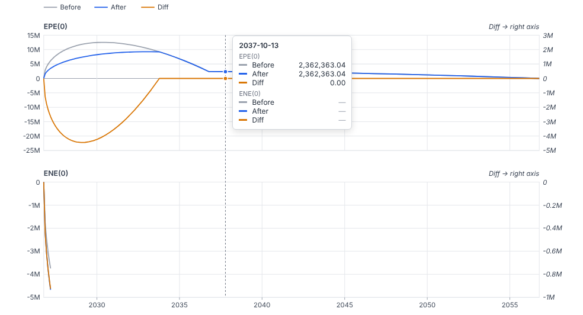 | 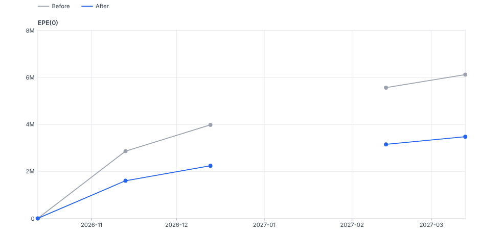 |

## The CDS page

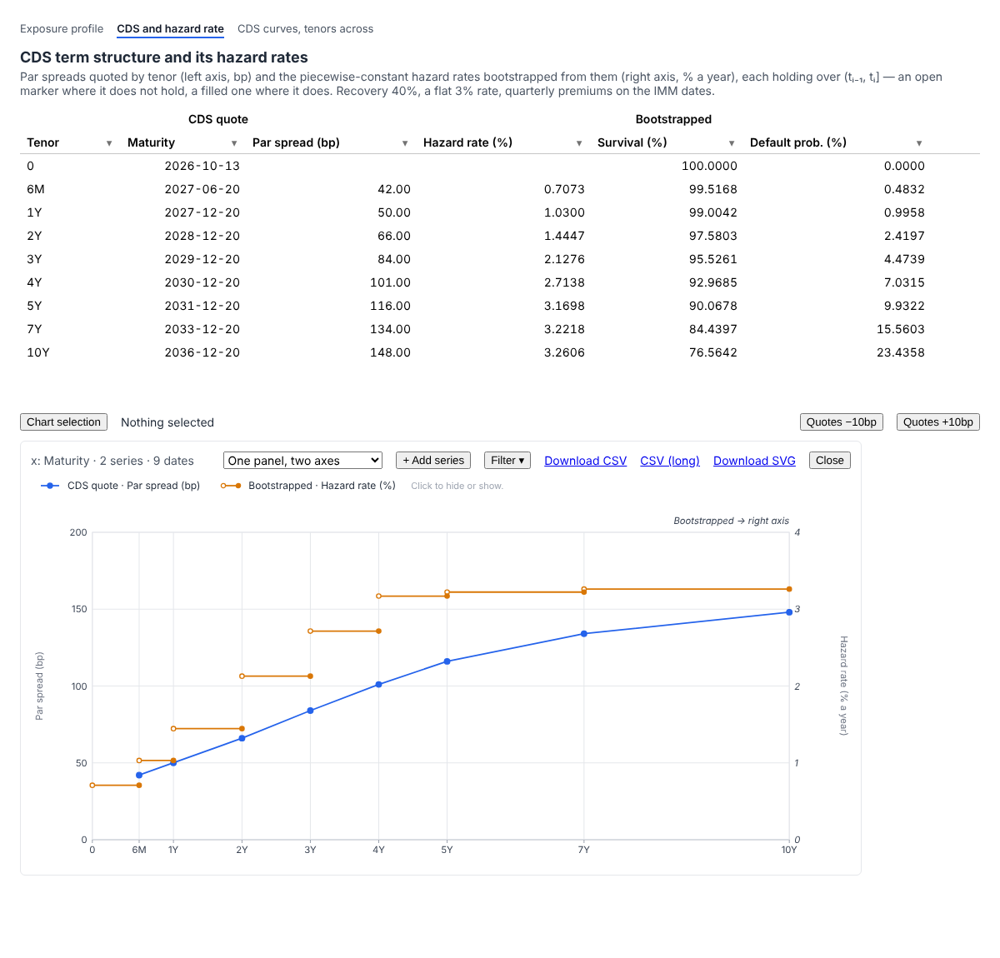

Par spreads by tenor read on the left axis (bp), drawn as points joined; the hazard rates read on
the right (% a year), drawn as what they are — piecewise constant over (tᵢ₋₁, tᵢ], filled where
the rate holds, open where it does not. The bootstrap (`Analytics/CdsData.cs`) prices each maturity's CDS at
par with the earlier intervals fixed: 40% recovery, a flat 3% rate, quarterly premiums on the IMM
dates (ACT/360) with half a period's accrual on default, the protection leg exact on each interval,
and the first coupon counted from today since the buyer is paid back what accrued before it (the
first hazard rate, 0.7073%, is s / (1 − R) at ACT/360). A first row at the curve's date carries no
quote and no hazard: it is where the first interval starts. The axis' ticks are the pillars,
labelled by the grid's Tenor column (`XLabel.Column`) — a tenor counted from today would read
"1894D" for a 5Y maturity on the roll. "Quotes ±10bp" bootstraps again, and the chart follows.

Writing the page, the grid refused it by name: a Header Group straddled the pinned column
(ADR-0032). The page pinned nothing instead.

## The curves page: series in rows

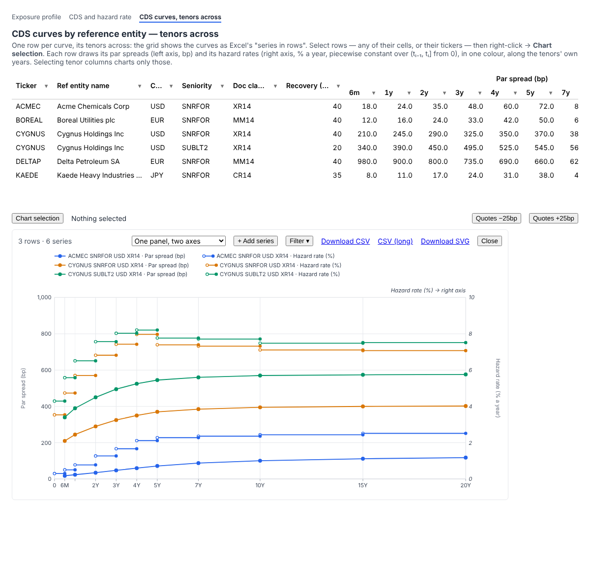

| | |
|---|---|
| 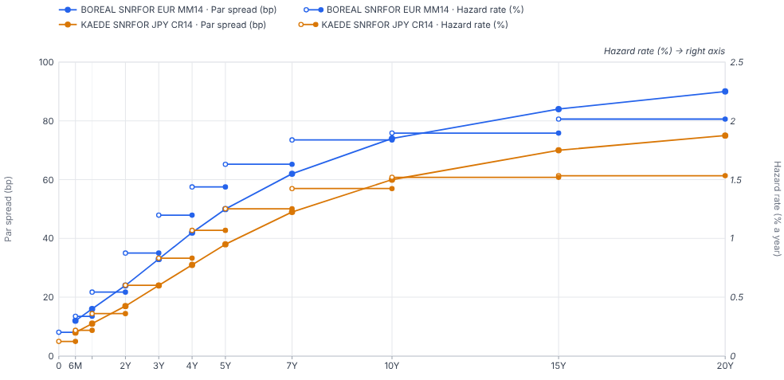 | 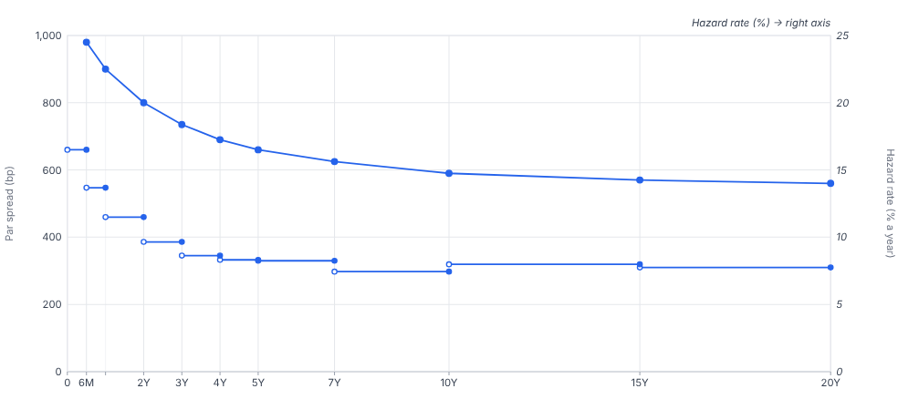 |

One row per reference entity — ticker, name, currency, seniority, doc clause, recovery — and its
tenors across, under two Header Groups: the par spreads, and the hazard rates bootstrapped with
the row's own recovery (`Analytics/CdsCurves.cs`; where no positive rate prices a quote the rate is left
empty, with every later one, rather than invented). This is Excel's "series in rows", and the
chart reads it so (`RowChartDefinition`, `RowChartSpec`):

- **A series is a row and a Header Group**: an entity's spreads, its hazard rates — one colour per
  row, a line with points for the spreads and a step over (tᵢ₋₁, tᵢ] from 0 for the hazard rates.
  It is named by the row's key and follows the row through a sort.
- **The axis is the tenors' own years, declared per column** — "6m" is a header's text, 0.5 is what
  the page says it stands for — so 6m to 1y is a tenth of 10y to 15y, not equal to it, as on
  Excel's category axis. The horizontal axis became a number with a scale (`XScale`): a date is
  its day number, a tenor its years.
- **Which way a selection is read is declared, not guessed from its shape.** Selected rows across
  tenor columns chart those tenors; rows with no tenor column (their tickers) chart their whole
  curves. A number column with no position — the recovery rate — selected with tenors is refused
  by name: it was chosen, and this axis has no place for it.

## The FX volatility surface page


| | |
|---|---|
| 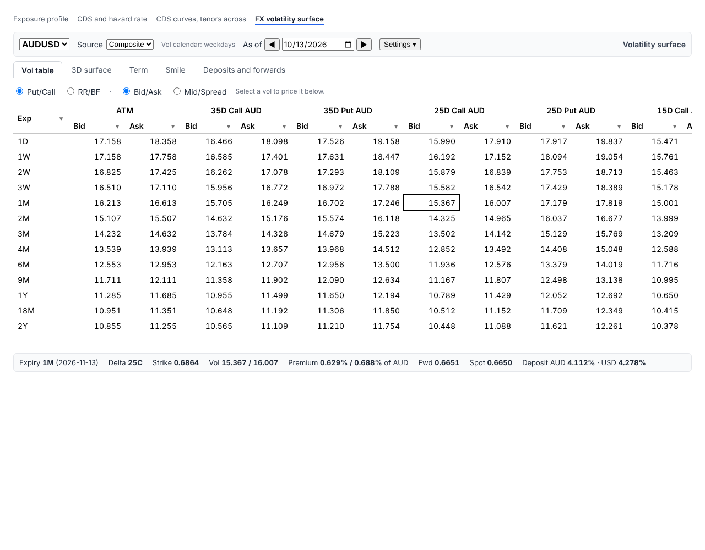 | 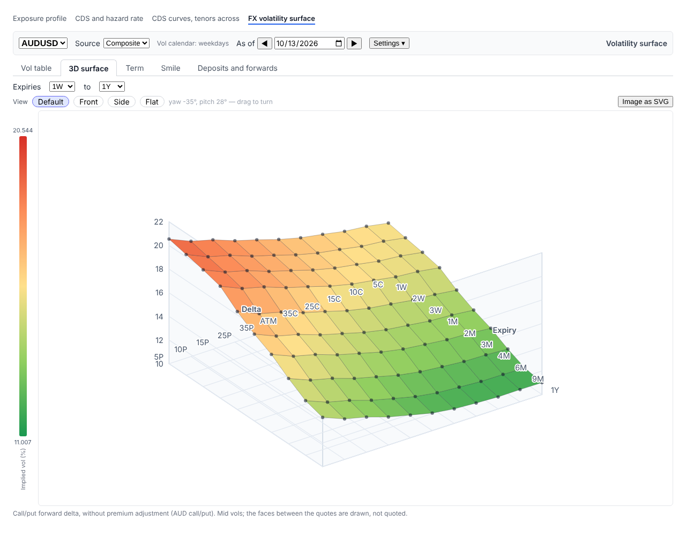 |
| 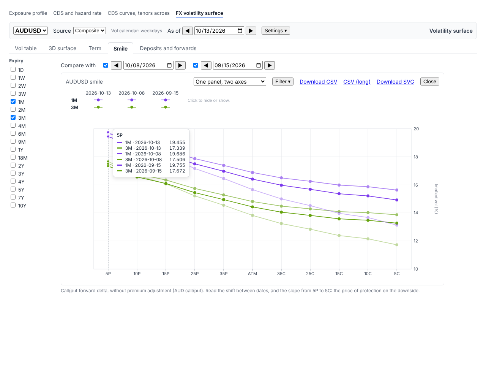 | 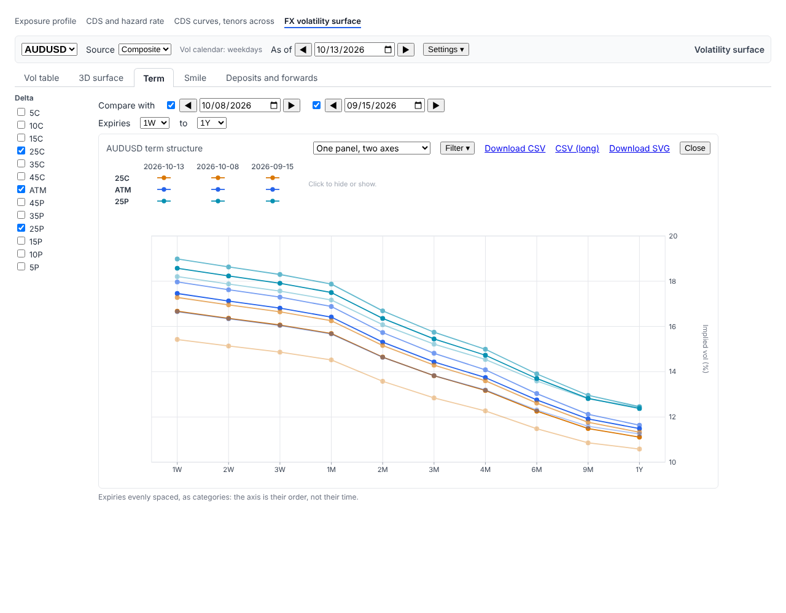 |
| 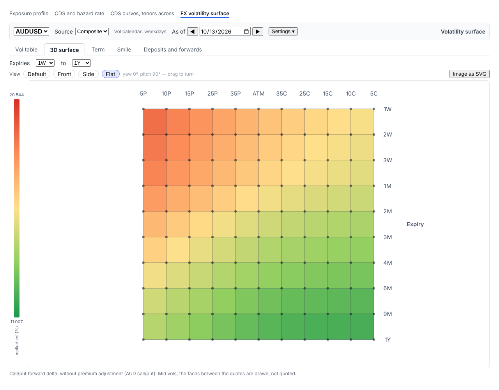 | 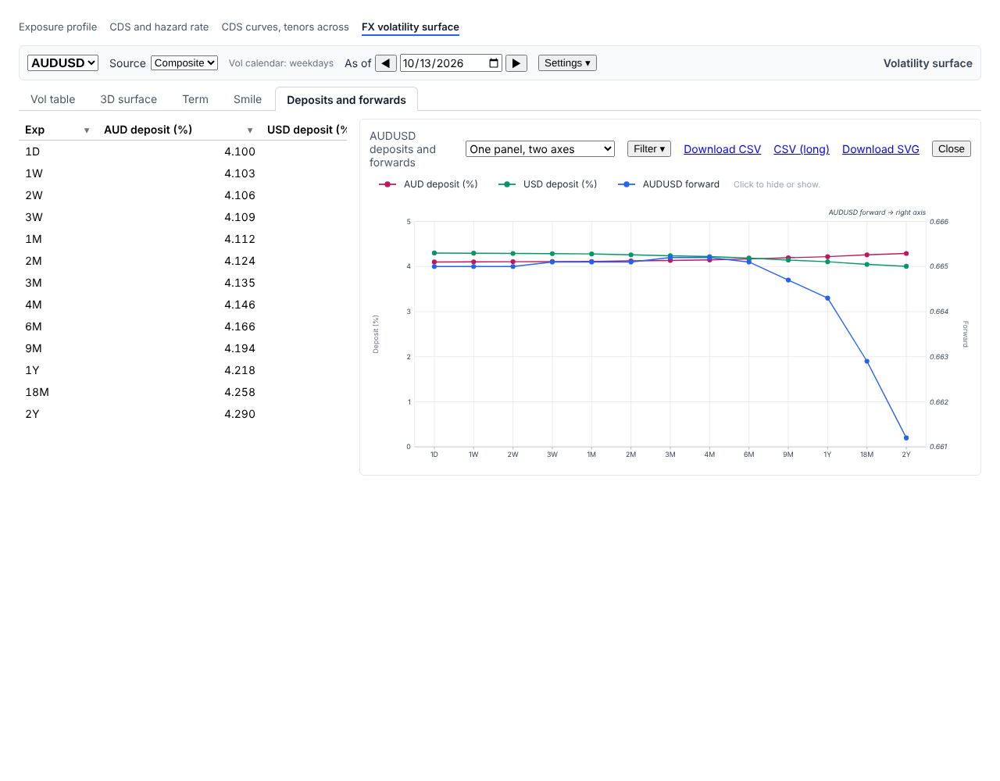 |

`/fxvol` follows what a market screen's FX volatility surface offers — as a training video of one
showed it, summarised for this session by another Claude session on the user's machine — in
ExGrid's own look, not the screen's. Every figure is invented, in `Analytics/FxVol.cs`: the
surface by pair, source and date, in both quoting forms, bid and ask; the deposits and forwards;
a quick pricer (Garman–Kohlhagen, the strike from a forward delta without premium adjustment).

- **Header**: the pair, the source, the volatility calendar (said, not chosen: weekdays), the date
  with weekday steppers, and Settings — the expiries and deltas kept, the quoting form and the side.
- **Vol table**: expiries down; each pillar a Header Group over its two columns — ATM, then each
  delta's call and put (Put/Call) or its risk reversal and butterfly (RR/BF), each as Bid/Ask or
  Mid/Spread. Both forms are the analytics'; the grid only shows the one asked for. Selecting a vol
  prices it in the strip below: strike, premium at the bid and the ask, forward, spot, deposits.
- **3D surface**: delta across (5P … ATM … 5C), expiry along, vol up, coloured green → yellow →
  orange → red with its scale beside, the mesh over the faces and a point at each quote; an
  expiry range; turned with the pointer, or set Default, Front, Side or Flat (seen from above, a
  heat map). Saved as SVG on request. The delta convention is said under it.
- **Term**: a delta list, two earlier dates to compare, an expiry range; expiries evenly spaced as
  categories (`XScale.Categories`), the vol axis on the right only, not from zero.
- **Smile**: an expiry list and two comparison dates stepped a weekday at a time; deltas as
  categories, puts on the left; each date a shade of its expiry's colour, today the full one
  (`ChartSeries.Shade`); the legend a table of expiry by date.
- **Deposits and forwards**: the table, and both deposits on the left with the forward on the right,
  which is not drawn from zero (`ChartSeries.FromZero`) — a forward rate read from 0 is a flat line.

How it is drawn:

- **The term structure, the smile and the rates are `ChartBox`**, through a `PrebuiltChart`: the
  page assembles the series, and the tooltip, the legend, the filter, the styles and the files are
  the same as on every other page.
- **The 3D surface is JavaScript** (`wwwroot/surface3d.js`; allowed by the user for 3D rotation,
  2026-10-13 — the ADR is the grilling's to write). .NET decides the mesh, its colour scale and its
  ticks and hands them over whole; the module only projects, sorts the faces far to near, fits the
  drawing to its box at every angle, and follows a drag with no round trip. It reports the angles
  when a drag ends, so the view is the page's and a redraw keeps it.
- Writing it met two of CLAUDE.md's traps again: the page named `FxVol` hid the analytics' class
  `FxVol` (the page is `FxVolPage`), and a grid's columns built inside markup are a new list every
  render (they are built once per change).

Run on both hosts, every tab driven by Playwright, the same readings and no console warnings on
Server and on WebAssembly.

## The legend

| | |
|---|---|
| 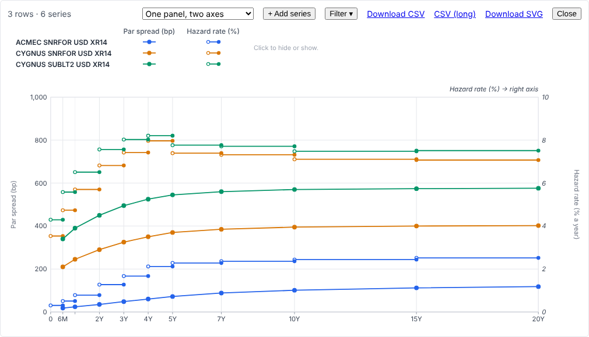 | 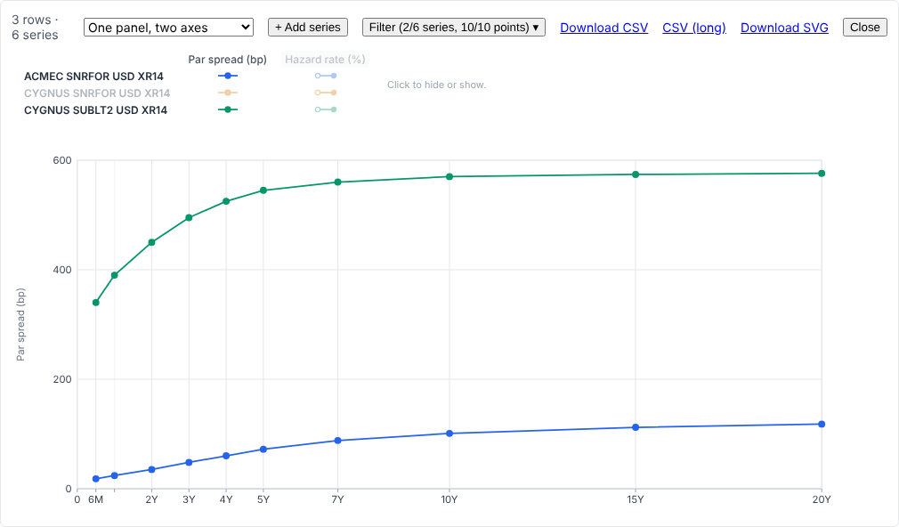 |
| 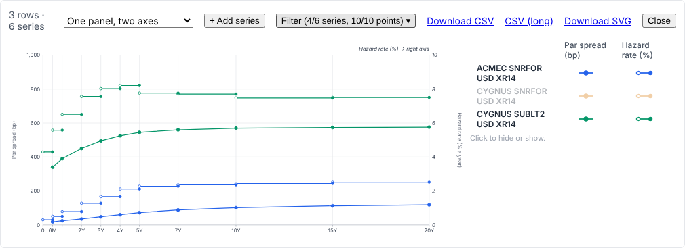 | 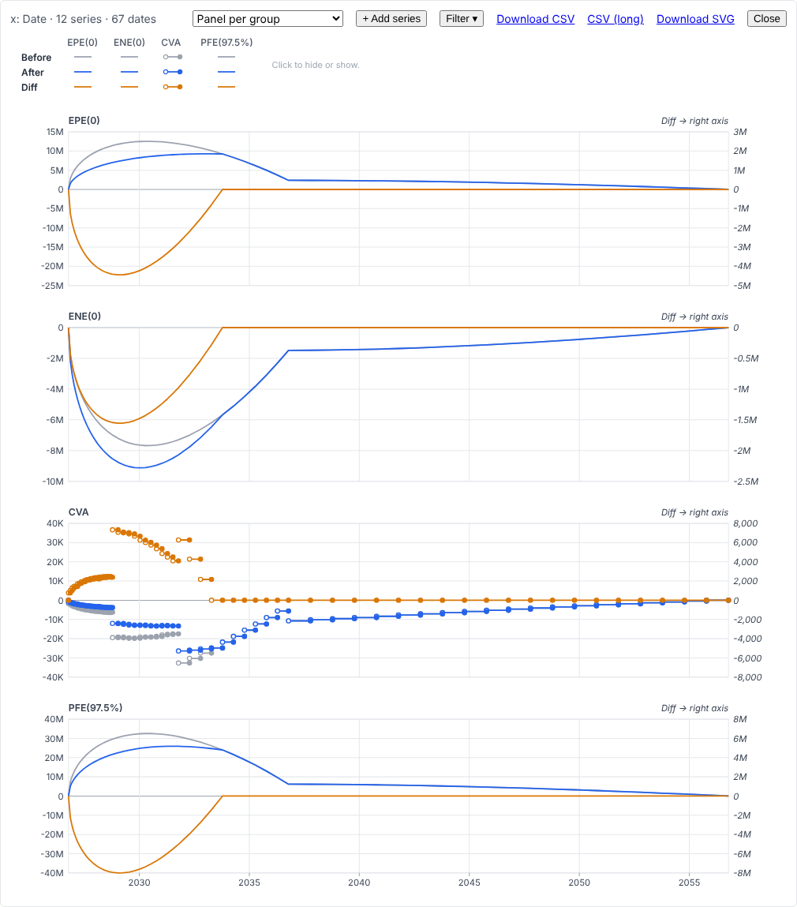 |

The page's legend is HTML beside the drawing, not part of it, so that it can be clicked; the
downloaded SVG carries its own. Filter → Legend sets where it stands (top, right, bottom, none)
and its form: a list, one entry per series, or a table — a colour per row, a drawing per column
(the curves page: each entity × its spreads and hazard rates; the exposure page: Before / After /
Diff × EPE, ENE, CVA, PFE). Auto chooses the table only when every cell of it holds a series: a
table with holes reads worse than the list. A click hides an entry, a row's header or a column's
header hides all it names, and a click on something wholly hidden shows it again; hidden entries
stay in the legend, faded, so they can be found. It is the filter's own state, so both agree.
Each sample is drawn as its series is — a line, points, a step's open and filled ends.

## What is computed where

The profile, the bootstrap and the hazard rates are under `Analytics/`, which stands for the risk
system: computed outside the chart and the grid, and put in the grid's rows by the page, as a
Consumer would put what its analytics returned (decided with the user, 2026-10-13: a bootstrap
belongs to analytics, never to the chart package). Nothing under `Charting/` or `ChartBox`
refers to it. The chart knows a hazard rate only by its column's declarations — the right axis,
"% a year", a step over (tᵢ₋₁, tᵢ] — which is the analytics' convention, said by the Consumer.

## How it is built

- **No change to the core.** The context menu's Consumer command (ADR-0036) already carries the
  selected ranges and the Row Sequence Version they were taken under; that is all a chart needs.
- **The chart is defined in the data's terms** (`ChartDefinition`): the axis column, and series
  each made of a column and **dates of its own** (decided with the user, 2026-10-13), as each Excel
  series has its own ranges. A sort or a recalculation leaves it meaning the same thing; a stale
  version is refused (spine rule 6). Ranges selected over different rows no longer refuse: each
  column is charted at the rows its ranges covered. The axis spans every series' dates, with a
  hover band at each; a series with no point at a date reads "—" there, which is not "(no value)".
- **A line joins only neighbours in the data.** A series charted over two stretches of rows is
  not drawn across the rows between them, whose values it does not show; a step's interval runs
  to the data's previous or next date, the bucket being the data's, not the series'.
- **Nothing is guessed.** Headers are not data; series names and panels come from the Header
  Groups ("EPE(0) · Before"); the axis is the one Date column, and a selection without one, with
  two, or with a text column is refused by name.
- **SVG written in C#** (`ChartSvg`). The hover guide and the dots are CSS `:hover`, instant and
  with no circuit traffic. The downloaded file carries a native `<title>` per date instead of a
  tooltip, since it has no page to draw one.
- **The tooltip is one listener, in ADR-0029's shape** (`ExposureChart.Pages/wwwroot/exposure-chart.js`; the user
  allowed widening the JavaScript allowlist for it, 2026-10-13 — the ADR is for the grilling to
  write). It reports the date under the pointer **only when it changes** and when the pointer
  leaves — 48 frames on the circuit for 89 mousemoves across 44 dates — and never measures: Blazor
  draws the tooltip at a percentage of the chart's width that C# computed. Each report carries the
  drawing's version, and one taken against an earlier drawing (a filter changed meanwhile) is
  dropped, not shown against the new one (spine rule 6). Values read through the column's own
  format, so the tooltip and the cell say the same digits.
- **Chart Filters, as Excel's funnel beside a chart** (`ChartView`): series by checkbox, by
  Header Group, or by leaf across every group ("hide every Before"); dates by a From/To range or a
  horizon (1Y / 5Y / 10Y / All) rather than Excel's one checkbox per category, which for 67 dates
  is a list nobody reads. It narrows the chart and its CSV, never the grid or the definition, and
  a hidden series keeps its colour slot so "After" stays blue when "Before" goes.
- **How points are joined is declared per series** (`SeriesStyle`, chosen per Header Group under
  Filter → Style): a line, a line with points, points only, or a step — over (tᵢ₋₁, tᵢ] or over
  [tᵢ, tᵢ₊₁). A step is drawn as mathematics draws one: the end that takes the value is a
  filled marker, the end that does not is an open one, and where the next level is equal the
  function is continuous and no open marker is drawn; there is no vertical riser, since the
  function takes no value between the levels. Markers are a circle, a square, a diamond or a
  triangle. CVA defaults to the (tᵢ₋₁, tᵢ] step, because that is the piecewise-constant profile
  its bucket-by-bucket integral uses; a line between the dates would show a profile the
  calculation never saw.
- **The horizontal axis is set in three independent choices** (`XAxisStyle`, Filter → Horizontal
  axis): where the ticks go (calendar boundaries, every date in the data, or the market's tenors
  from the first date — 1M, 3M, 6M, 1Y, 2Y, 5Y, 10Y …), how they are labelled (yyyy, yyyy-MM,
  yyyy-MM-dd, MMM yyyy, or a tenor, "18M", "5Y"), and at what angle (0°, 45°, 90°, read upwards
  as in Excel). A label that would touch its neighbour is left out — never overprinted — and
  the panel says how many of the ticks are labelled; every tick is still drawn. The room under
  the last panel grows with the angle and the longest label. Labels are not measured: an
  estimate per character decides both (ADR-0021).
- **Series are added to a chart already drawn** (Excel's Select Data → Add): "+ Add series" lists
  the number columns not yet in it, by Header Group — added at the chart's dates, since a list of
  columns names no rows — or adds the grid's current selection, each column at the rows it covered. A new group
  becomes a new panel, and its Before / After / Diff take the colours those leaves already have.
- **Two CSVs.** The wide one (a row per date, a column per series) cannot tell an empty cell
  that is a missing value from one where the series is not charted; the long one (Series, Date,
  Value — a row per point) can, its empty Value being only ever a missing one.
- **CSV with no script**: a `data:` URL behind `<a download>`, UTF-8 with a byte-order mark (Excel
  on a Japanese Windows otherwise reads Shift_JIS), invariant, unformatted, every digit; a missing
  value is an empty field, never a zero.

## What it costs (measured 2026-10-13)

The exposure page, the whole table charted (12 series), Blazor Server in Release on this cloud
container (4 vCPUs, Linux), headless Chromium on the same machine — so **no network latency and no
bandwidth limit**; a real circuit adds both. `?every=7` and `?every=1` swap the tenor grid for a
weekly or daily one to 30Y. Server time is read from `data-build-ms` (model, both drawings, both
CSVs); bytes are the WebSocket frames the browser received.

| Dates | Server build (redraw) | Drawing / file SVG / CSVs | Open the chart | Redraw (legend click) | Hover to the next date | DOM nodes |
|---|---|---|---|---|---|---|
| 67 (tenor grid) | 5 ms | 131 KB / 155 KB / 9 + 29 KB | 249 ms, 462 KB | 83 ms, **428 KB** | 30 ms, 3 KB | 1,875 |
| 1,566 (weekly) | 88 ms | 2.7 MB / 3.3 MB / 0.2 + 0.7 MB | 1.3 s, 9.0 MB | 705 ms, **9.0 MB** | 60 ms, 3 KB | 33,678 |
| 10,959 (daily) | — | 18 MB / 22 MB / 1.3 + 4.6 MB | 11.7 s, 61 MB | 6.7 s, **61 MB** | 263 ms, 3 KB | 224,145 |

**WebAssembly** (measured the same day, the same machine: published Release, no AOT, served
statically; "build" is then .NET in the browser):

| Dates | Build (redraw) | Open the chart | Redraw (legend click) | Hover to the next date |
|---|---|---|---|---|
| 67 | 107 ms | 535 ms | 199 ms | 30 ms |
| 1,566 | 1.1 s | 3.0 s | 1.8 s | **282 ms** |
| 10,959 | 8.1 s | 17.8 s | 13.5 s | **1.7 s** |

The Server host, rerun beside it: 67 dates 72 ms a redraw and 27 ms a hover, 1,566 dates 644 ms
and 62 ms, 10,959 dates 7.0 s and 228 ms — as before.

What it says:

- **On WebAssembly the build is the cost**: the same string building is about fifteen times slower
  in the browser's .NET without AOT (6 ms → 107 ms at 67 dates). AOT is not measured here.
- **A hover redoes work that has nothing to do with it.** It changes one tooltip, but ChartBox
  renders whole: the download links' `data:` URLs are encoded again (the file SVG and both CSVs,
  every time), every legend sample is written again, and the drawing's markup is compared again.
  On WebAssembly that is 282 ms per date crossed at 1,566 dates. The tooltip wants a component
  of its own with a hand-written `ShouldRender` (CLAUDE.md), and the files want writing when
  asked for, not per render.
- **The server is not the cost; the circuit and the DOM are.** Building is milliseconds; every
  redraw then sends the whole drawing again, and the page's download links carry the file SVG and
  both CSVs as `data:` URLs, URL-encoded — more than half of the 428 KB at 67 dates.
- **The hover layer is dates × series.** Each date's band holds a guide and a dot per series,
  written into the drawing: 1,618 of the page's 1,875 nodes at 67 dates, 224k at daily.
- **The tooltip stays cheap** (3 KB per date crossed) because the listener reports only a change
  of date — the shape ADR-0029 chose — but it slows with the DOM it lands in.
- **Past the plot's width in pixels, points stop adding information** and keep adding cost: 10,959
  dates on 816 px.

## What it showed

1. **One axis is unreadable for this table**, as predicted: CVA (tens of thousands) lies flat on
   an axis scaled by EPE (millions). A panel per Header Group is the right default.
2. **A right-hand axis for Diff costs half a panel.** Aligning the two zeros (so that no false
   level is drawn) stretches the left axis down to the Diff's negative extent: EPE(0) reads
   against −25M…15M. A Diff panel of its own may be better than a secondary axis.
3. **A per-bucket figure drawn as a line misleads.** CVA here is each bucket's contribution, and
   the tenor grid widens from monthly to quarterly to yearly, so the line jumps where the bucket
   width does. A series needs a declared kind — a level (EPE) or an amount per period (CVA by
   bucket), drawn as steps or bars, or normalised by the bucket's length.
4. **The tooltip was the weak point of "no JavaScript"**: a native `<title>` appears after about a
   second and cannot be styled. It is now a listener (above). On the Server host the tooltip
   follows the pointer one round trip behind; the guide line, being CSS, does not.
5. **Text is not measured**, so the legend wraps on an estimate per character (ADR-0021).
6. **The rows a selection names are the shown rows.** Under a filter, the chart is of what was
   visible; "the whole table" means the Window, not the Consumer's data.
7. **A gesture must carry only what it changes.** The style controls first sent the whole style
   they were rendered with; on the Server host, choosing a Draw and then a Marker within one round
   trip put the Draw back. Each control now changes its one field on the style as it is when the
   event is handled (spine rule 6) — the kind of race only machine-speed driving shows.
8. **Charts beyond this one** (risk ladders by tenor, PL Explain waterfalls, HPL-vs-RTPL scatter for
   PLA) put a category or a number on the horizontal axis; the category's order then matters,
   and this PoC does not answer it.
