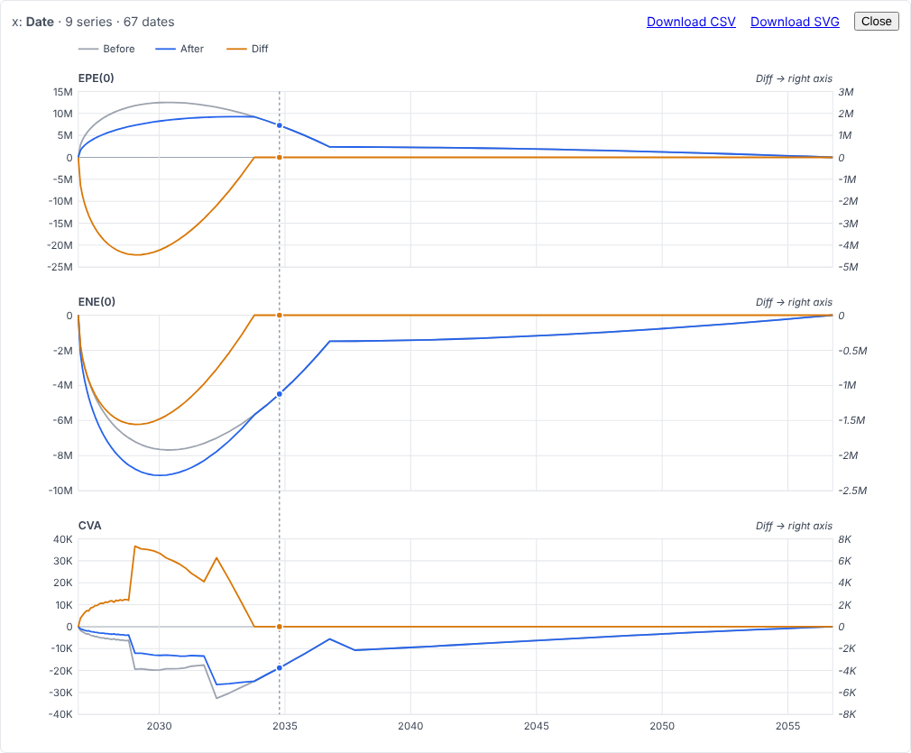
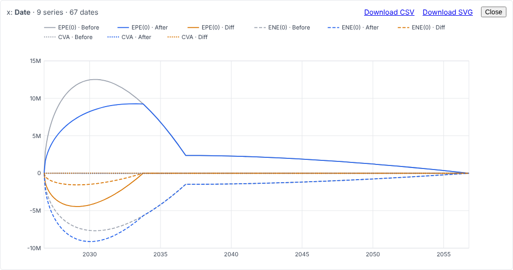

# exposure-chart — a disposable proof of concept

What charting an ExGrid selection would look like, before any ADR is written: an exposure profile
(Date × EPE(0) / ENE(0) / CVA, each Before / After / Diff, under Header Groups), a selection
turned into a chart, and the chart's data exported as CSV. **Nothing here is a decision**; it is
the material for the grilling that follows it. Throw it away once that is done.

```sh
nix develop -c dotnet run --project spikes/exposure-chart -- --urls http://localhost:5410
```

Select **Date** and the figures (drag, or click a header and Ctrl+click others), then right-click
→ **Chart selection**, or the button. One selected cell charts the whole table, as in Excel.

| | |
|---|---|
|  |  |

## How it is built

- **No change to the core.** The context menu's Consumer command (ADR-0036) already carries the
  selected ranges and the Row Sequence Version they were taken under; that is all a chart needs.
- **The chart is defined in the data's terms** (`ChartDefinition`): the axis column, the series
  columns by name, the rows by their date. A sort or a recalculation leaves it meaning the same
  thing; a stale version is refused (spine rule 6).
- **Nothing is guessed.** Headers are not data; series names and panels come from the Header
  Groups ("EPE(0) · Before"); the axis is the one Date column, and a selection without one, with
  two, or with a text column is refused by name.
- **SVG written in C#** (`ChartSvg`), one string that is both the picture and the download. The
  hover guide, the dots and the readout are CSS `:hover` and a native `<title>` — no JavaScript,
  nothing over the circuit while the pointer moves.
- **CSV with no script**: a `data:` URL behind `<a download>`, UTF-8 with a byte-order mark (Excel
  on a Japanese Windows otherwise reads Shift_JIS), invariant, unformatted, every digit; a missing
  value is an empty field, never a zero.

## What it showed

1. **One axis is unreadable for this table**, as predicted: CVA (tens of thousands) lies flat on
   an axis scaled by EPE (millions). A panel per Header Group is the right default.
2. **A right-hand axis for Diff costs half a panel.** Aligning the two zeros (so that no false
   level is drawn) stretches the left axis down to the Diff's negative extent: EPE(0) reads
   against −25M…15M. A Diff panel of its own may be better than a secondary axis.
3. **A per-bucket figure drawn as a line misleads.** CVA here is each bucket's contribution, and
   the tenor grid widens from monthly to quarterly to yearly, so the line jumps where the bucket
   width does. A series needs a declared kind — a level (EPE) or an amount per period (CVA by
   bucket), drawn as steps or bars, or normalised by the bucket's length.
4. **The tooltip is the weak point of "no JavaScript".** A native `<title>` appears after about a
   second and cannot be styled. A real readout needs the pointer reported, which is ADR-0029's
   kind of listener — an allowlist question.
5. **Text is not measured**, so the legend wraps on an estimate per character (ADR-0021).
6. **The rows a selection names are the shown rows.** Under a filter, the chart is of what was
   visible; "the whole table" means the Window, not the Consumer's data.
7. **Charts beyond this one** (risk ladders by tenor, PL Explain waterfalls, HPL-vs-RTPL scatter for
   PLA) put a category or a number on the horizontal axis; the category's order then matters,
   and this PoC does not answer it.
